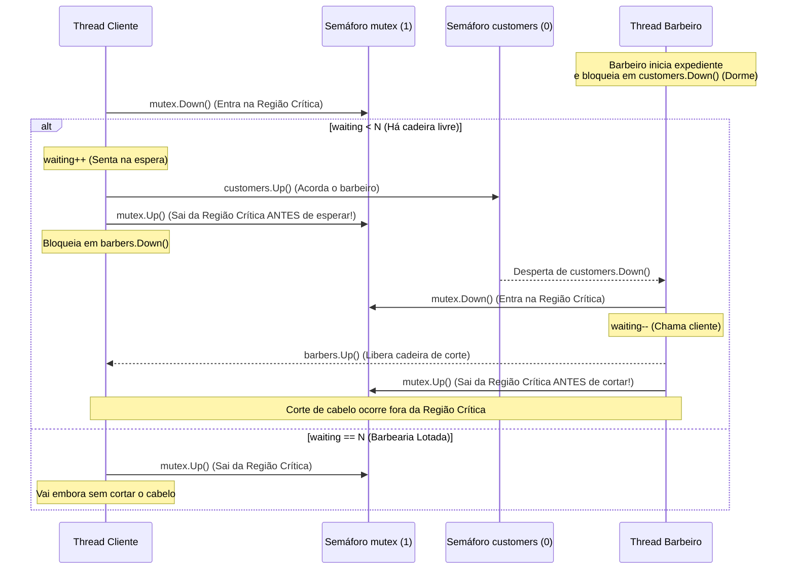

# 🧵 Comunicação e Sincronização de Processos e Threads


-00ADD8?style=for-the-badge&logo=go&logoColor=white)


> **Pontifícia Universidade Católica de Minas Gerais (PUC Minas)**  
> **Instituto de Ciências Exatas e Informática (ICEI)** — *Curso de Engenharia de Software*  
> **Disciplina:** Sistemas Operacionais  
> **Professor:** Diego Silva Caldeira Rocha  
> **Atividade:** Trabalho Prático 1 — *Comunicação e Sincronização de Processos e Threads*

---

## 📌 Sobre o Projeto

Este repositório reúne o desenvolvimento do **Trabalho Prático 1** da disciplina de **Sistemas Operacionais**, focado no estudo prático de **concorrência, exclusão mútua, regiões críticas, semáforos e prevenção de *deadlocks*** e ***race conditions*** (condições de corrida).

O trabalho está dividido em duas partes complementares:

1. **Parte I (`ProdutorConsumidor/` — Java):** Estudo, compilação e execução do clássico **Problema do Produtor e Consumidor** (*Bounded Buffer Problem*), utilizando monitores nativos da linguagem Java (`synchronized`, `wait()` e `notifyAll()`).
2. **Parte II (`BarbeiroDorminhoco/` — Go):** Modelagem, implementação do zero ("na unha") e validação por testes do clássico **Problema do Barbeiro Dorminhoco** (*The Sleeping Barber Problem*, proposto por Dijkstra / Tanenbaum), utilizando **threads concorrentes (*goroutines*)** e **semáforos clássicos implementados manualmente**.

---

## 🗂️ Estrutura do Repositório

```text
SincronizacaoThreads/
├── ProdutorConsumidor/          # Parte I — Produtor e Consumidor (Java)
│   ├── Buffer.java              # Recurso compartilhado com controle synchronized / wait / notifyAll
│   ├── Produtor.java            # Thread produtora que insere valores no buffer
│   ├── Consumidor.java          # Thread consumidora que extrai valores do buffer
│   └── ProdCons.java            # Classe principal (main) que dispara as threads
│
├── BarbeiroDorminhoco/          # Parte II — Barbeiro Dorminhoco (Go)
│   ├── semaforo.go              # Implementação "na unha" do Semáforo de Dijkstra (Down / Up)
│   ├── barbearia.go             # Estado compartilhado (waiting), os 3 semáforos e interface visual
│   ├── barbeiro.go              # Linha de execução da Thread do Barbeiro
│   ├── cliente.go               # Linha de execução da Thread do Cliente
│   ├── validacao.go             # Simulações em 3 etapas, Navegador de Replay e Testes de Validação
│   ├── main.go                  # Menu interativo principal no terminal
│   ├── go.mod                   # Definição do módulo Go
│   └── go.sum                   # Checksums de estilização visual do terminal
│
├── .gitignore                   # Regras de exclusão de binários (.class, .exe, IDEs)
├── LICENSE                      # Licença MIT do projeto
└── README.md                    # Documentação completa do trabalho
```

---

## ☕ Parte I — Problema do Produtor e Consumidor (Java)

### Contextualização
O **Problema do Produtor e Consumidor** (*Bounded Buffer Problem*) consiste na sincronização de threads concorrentes que compartilham um mesmo buffer de memória de tamanho fixo:
* O **Produtor** insere novos dados no buffer (`put`), devendo aguardar (`wait()`) caso o buffer já esteja cheio (`cheio == true`).
* O **Consumidor** retira dados do buffer (`get`), devendo aguardar (`wait()`) caso o buffer esteja vazio (`!cheio`).
* A cada inserção ou remoção concluída, a thread notifica as demais (`notifyAll()`) liberando o monitor.

### Como Compilar e Executar (Parte I)

Na raiz do repositório, execute no terminal:

```powershell
javac ProdutorConsumidor/*.java
java ProdutorConsumidor.ProdCons
```

---

## 💈 Parte II — Problema do Barbeiro Dorminhoco (Go)

### 1. Descrição do Problema (Tanenbaum, Figura 1.20)
Em uma barbearia há **1 barbeiro**, **1 cadeira de barbeiro** (onde ocorre o corte) e **$N$ cadeiras de espera** para os clientes:
* Quando não há clientes na barbearia, o barbeiro senta-se na sua cadeira e **dorme** (bloqueia sem consumir CPU).
* O primeiro cliente que chega encontra o barbeiro dormindo e o **acorda** para ser atendido.
* Se outros clientes chegarem enquanto o barbeiro estiver cortando o cabelo de um cliente:
  * **Se houver cadeira de espera disponível (`waiting < N`):** o cliente senta-se e aguarda sua vez.
  * **Se todas as $N$ cadeiras estiverem ocupadas (`waiting == N`):** o cliente desiste e **vai embora** sem cortar o cabelo.
* Ao terminar um corte, o barbeiro atende o próximo cliente esperando ou volta a dormir caso a sala esteja vazia.

---

### 2. Modelagem de Sincronização e Semáforos "Na Unha"

Seguindo rigorosamente a especificação teórica de Tanenbaum (página 6 do enunciado), a solução utiliza **1 variável inteira compartilhada** e **3 semáforos** (implementados do zero em `semaforo.go` com as operações atômicas `Down()` e `Up()` sem espera ocupada / *busy wait*):

| Elemento | Tipo | Valor Inicial | Papel na Sincronização |
| :--- | :---: | :---: | :--- |
| **`waiting`** | `int` | `0` | Conta quantos clientes estão aguardando nas $N$ cadeiras de espera ($0 \le \text{waiting} \le N$). Necessária pois não se lê o valor interno de um semáforo diretamente na lógica. |
| **`customers`** | `*Semaforo` | `0` | Semáforo contador de clientes à espera. O barbeiro executa `customers.Down()` (dormindo se for `0`) e o cliente executa `customers.Up()` para acordá-lo. |
| **`barbers`** | `*Semaforo` | `0` | Indica se o barbeiro está disponível (`0` ou `1`). O cliente executa `barbers.Down()` aguardando ser chamado para a cadeira de corte, e o barbeiro executa `barbers.Up()`. |
| **`mutex`** | `*Semaforo` | `1` | Semáforo binário de **Exclusão Mútua**. Protege a **Região Crítica** em todas as leituras e modificações da variável compartilhada `waiting`. |

---

### 3. Fluxo das Threads, Regiões Críticas e Prevenção de Deadlock



#### Estratégia Adotada para Evitar Deadlocks
Para eliminar a condição de **posse e espera** (*hold and wait*) e **espera circular** (Condições de Coffman):
1. **Na Thread do Cliente (`cliente.go`):** O cliente **sempre libera a Região Crítica (`mutex.Up()`) antes** de bloquear aguardando o barbeiro em `barbers.Down()`.
2. **Na Thread do Barbeiro (`barbeiro.go`):** O barbeiro aguarda novos clientes em `customers.Down()` **fora** do `mutex` e, após decrementar `waiting--` e sinalizar `barbers.Up()`, **libera `mutex.Up()` antes** de iniciar o procedimento `cortarCabelo()`. Dessa forma, novos clientes conseguem entrar na sala de espera enquanto o corte está em andamento.

---

### 4. Visualização no Terminal em 3 Etapas e Validação por Testes

Para tornar a execução concorrente clara e didática, o programa em Go conta com um **Menu Interativo Estilizado** no terminal:

1. **Opção `[1]` e `[2]` — Simulação em 3 Etapas:**
   * **Etapa 1 (Visualização Ao Vivo):** Desenha a **Planta da Barbearia** (Cadeira do Barbeiro + $N$ Cadeiras de Espera + Placar + Explicação do Semáforo acionado), exibindo cada evento por **2 segundos** para leitura confortável.
   * **Etapa 2 (Histórico Completo):** Ao término da execução, apresenta a tabela cronológica completa de todos os eventos numerados (`#01` até o fim) e o resumo estatístico.
   * **Etapa 3 (Navegador Interativo de Replay Passo a Passo):** Permite avançar (`[ENTER]` / `[P]`), voltar (`[A]`) ou pular diretamente para qualquer passo (`[1..N]`), congelando a Planta da Barbearia exatamente como estava naquele instante.
2. **Opção `[3]` — Suíte de Testes de Validação (`validacao.go`):**
   * **Teste 1 (Fluxo Espaçado — Dormir e Acordar):** Verifica que o barbeiro dorme quando não há clientes, acorda a cada chegada e atende 100% dos clientes sem desistências.
   * **Teste 2 (Controle de Lotação — `waiting <= N`):** Dispara uma rajada simultânea de 12 clientes para $N=4$ cadeiras, validando que o limite das cadeiras jamais é ultrapassado e que os clientes excedentes desistem sem bloquear.
   * **Teste 3 (Estresse com 50 Threads Concorrentes + Anti-Deadlock):** Executa 50 threads clientes concorrentes com verificação de invariantes (`0 violações de região crítica`, `Atendidos + Desistiram == 50`) e *timeout* contra *deadlock*.

---

### ▶️ Como Compilar e Executar (Parte II — Go)

1. Certifique-se de ter o **Go (Golang)** instalado (`winget install GoLang.Go` no Windows).
2. Acesse a pasta `BarbeiroDorminhoco` e execute:

```powershell
cd BarbeiroDorminhoco
go run .
```

---

## 📄 Licença

Este projeto está licenciado sob a **Licença MIT** — consulte o arquivo [LICENSE](LICENSE) para mais detalhes.

